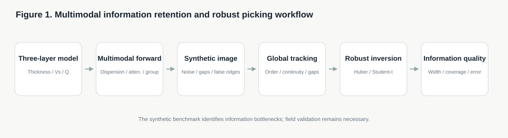
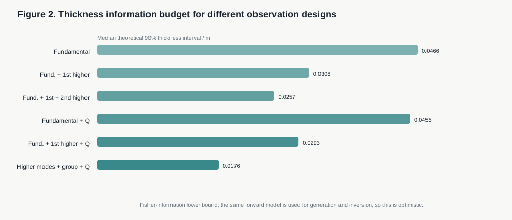
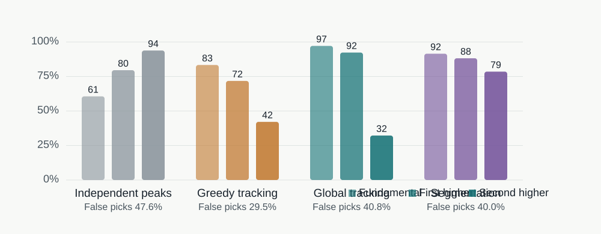
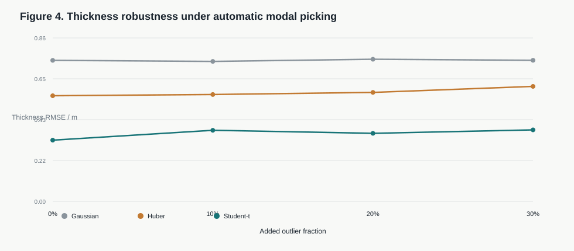
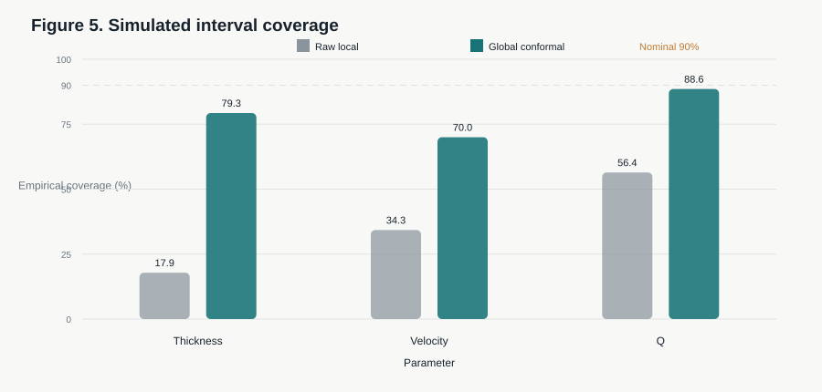
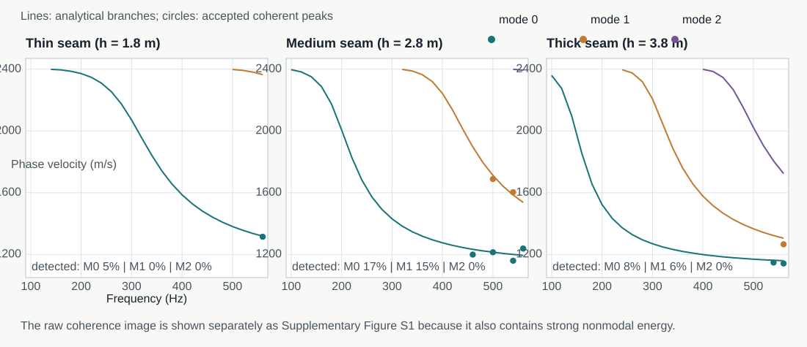
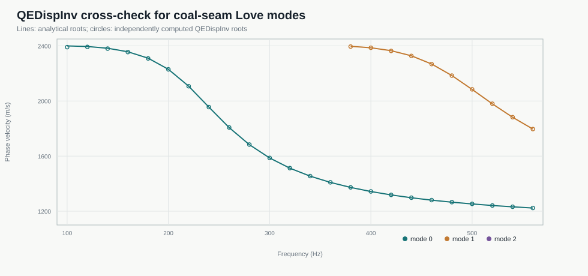
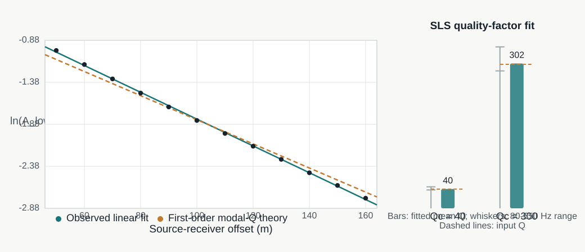

# Retaining Higher-Mode Love Waves Through Automatic Dispersion Tracking: A Controlled Study of Coal-Seam Thickness Inversion and Interval Reliability

**Author:** Lu Bin

**Affiliation:** Wenzhou University of Technology, Wenzhou, Zhejiang, China

**Corresponding author:** Lu Bin (lubin2000@163.com)

**Manuscript status:** English research draft v0.3. This is a controlled synthetic study intended for an English-language applied-geophysics journal. Author, affiliation, funding and licensing information have been completed. Field-data validation and the public repository DOI remain to be completed before submission.

## Highlights

- Higher-mode Love waves reduce theoretical thickness uncertainty, but less than an earlier mislabeled-branch analysis implied.
- The first higher mode is observable at only about 61% of frequencies.
- Fixed-slot order tracking preserves continuity but does not guarantee better parameter information.
- Student-t inversion reduces outlier-induced parameter bias under 0-30% contamination.
- Robust point estimates do not provide trustworthy 90% parameter intervals.

## Abstract

Higher-mode Love waves can provide additional constraints on coal-seam thickness, shear-wave velocity and quality factor, but their practical value depends on mode availability, branch identity, automatic dispersion picking and robustness to false ridges. We present a controlled synthetic study that connects mode-level information content to automatic tracking and robust parameter inversion in a three-layer coal-seam model. An exact Love-wave dispersion equation is combined with energy-weighted modal attenuation and group-velocity calculations. Mode indices are assigned explicitly to orders \(n=0,1,2\) and are never reassigned by sorting roots according to phase velocity. Linearized Fisher information gives a median theoretical 90% thickness interval of 0.0466 m for fundamental-mode phase velocity, 0.0308 m after adding the first higher mode, and 0.0176 m when higher modes, group velocity and attenuation are combined. Across randomized models, the fundamental, first-higher and second-higher modes are available at approximately 93.6%, 60.9% and 31.3% of frequencies, respectively. Synthetic dispersion images containing coherent noise, missing ridges and a false body-wave ridge are used to compare independent peak picking, greedy tracking, fixed-slot global tracking and connected-component segmentation. Independent picking detects 60.6% of fundamental, 79.6% of first-higher and 93.8% of second-higher branches at a 47.6% false-pick rate. Global tracking raises fundamental and first-higher detection to 97.2% and 92.3%, but second-higher detection falls to 32.2%, illustrating the distinction between continuity and information recovery. The resulting picks are inverted using Gaussian, Huber and Student-t likelihoods under 0-30% added outliers. With 30% outliers, the Student-t likelihood reduces thickness root-mean-square error from 0.886 m for a Gaussian likelihood to 0.548 m using phase picks and to 0.378 m with attenuation, for which the relative Q error is 4.9%. Raw local 90% intervals cover thickness, velocity and Q in only 17.9%, 34.3% and 56.4% of an independent-model evaluation. Global split-conformal calibration raises these coverages to 79.3%, 70.0% and 88.6%, but the thickness and velocity intervals remain under-covered and broad. An independent 2D SH finite-difference check reproduces the analytical mode count at 70 of 72 model-frequency combinations; strict guided-peak detection remains frequency-selective and nonuniform across modes. QEDispInv independently reproduces all 34 tested coal-seam modal roots within 10 m/s, with a median difference of 0.48 m/s. A five-mechanism standard-linear-solid model fitted over 80-550 Hz predicts an effective fundamental-mode Q of 40.92 at 280 Hz, compared with 37.35 recovered from paired viscoelastic wavefields, an 8.7% difference. Direct tracking of independent finite-difference images produces much higher false-pick rates than controlled synthetic images. The study is synthetic: it supports a mode-information and reliability framework, not a field-accuracy claim.

**Keywords:** coal-seam channel waves; Love waves; higher modes; dispersion; attenuation; robust inversion; uncertainty quantification

## 1. Introduction

In-seam seismic (ISS) exploration uses the low-velocity coal seam as a seismic waveguide (Dresen & Rüter, 1994). Guided Love- and Rayleigh-type seam waves are sensitive to seam thickness, roof and floor properties, discontinuities and coal quality. Experience from surface-wave analysis shows that reliable dispersion processing requires careful treatment of mode identity and model non-uniqueness (Socco & Strobbia, 2004; Foti et al., 2018). Conventional ISS processing usually relies on manually picked dispersion ridges and primarily uses the fundamental mode to estimate velocity or thickness. This workflow has two fundamental limitations. First, higher-mode availability and information content are rarely quantified. Second, manual or local automatic picking can fail in the presence of coherent noise, crossing branches and false body-wave energy.

Early channel-wave studies established the physical basis used here. Räder et al. (1985) calculated Love-wave dispersion and amplitude-depth distributions for horizontally layered media and showed that interlayers and complex seam structures can generate secondary group-velocity minima and overlapping branches. Breitzke and Dresen (1986) used finite-difference modeling to study seam interruptions, seam terminations and washouts. Transmission and reflection amplitudes, spectra and slowness changed with washout geometry, while different geometries could produce similar records. Buchanan (1986) developed an SH channel-wave scattering matrix for faults and showed that reflection and transmission depend strongly on frequency, fault dip and throw. These studies demonstrate that a single dispersion branch or a single wave packet is not a sufficient model of the observed wavefield.

Evison (1955) provided an early field demonstration that a coal seam can guide seismic energy. Buchanan et al. (1983) subsequently measured channel-wave attenuation and horizontal anisotropy between 50 and 500 Hz. They reported an approximately linear increase in attenuation with frequency, values of about 0.096 dB/m at 100 Hz and 0.229 dB/m at 300 Hz, and an equivalent quality factor of about 45 near 475 Hz. They also showed that ignoring directional anisotropy can bias fault locations by approximately 10%. These results establish attenuation as a separate physical observable rather than a minor amplitude correction.

Asten et al. (1984) modeled Love-wave scattering at faults, fracture zones and dikes using the finite-element method. Fault throw produced frequency-dependent reflection and fundamental-to-higher-mode conversion, while the strongest reflection from a thin dike occurred near a quarter-wavelength thickness. The authors explicitly noted that field exploitation of higher modes requires acquisition and processing designed to recognize them. This remains a central motivation for studying higher-mode retention.

Modern three-dimensional modeling has further demonstrated that real seam-wave fields contain multiple guided and non-guided wave types. Essen (2010) studied Rayleigh-type seam waves around disturbed seams and mine roadways. Al-Towairqi (2010) used three-dimensional elastic finite differences to investigate generalized Love and Rayleigh modes in thin seams. Ji et al. (2012) modeled roadways with high-order staggered-grid finite differences and the image method, showing that roadway walls generate strong roadway modes while the seam interior is dominated by Love-type waves. Pi et al. (2018) combined numerical and physical modeling and showed that the partitioning, leakage and dominant frequency of Love and Rayleigh energy vary with seam thickness.

Essen et al. (2007) used Green's functions and parallel viscoelastic finite differences to model disturbed seams and roadways. Simple three-layer seams were dominated by the fundamental Rayleigh mode, whereas a high-velocity interlayer could excite higher modes. Washouts, faults and seam splits generated mode conversion and S-wave radiation into the surrounding rock. Their results demonstrate that higher-mode energy may originate from structural complexity and may not represent a continuous thickness-sensitive branch.

Anisotropy introduces an additional interpretation problem. Ji et al. (2019) derived Love-wave dispersion and amplitude-depth distributions for a weakly anisotropic HTI coal seam containing near-vertical fractures and simulated the corresponding three-dimensional wavefield. The fundamental Love branch differed only slightly from the isotropic case, whereas higher branches showed stronger differences. Seam thickness mainly shifted the Airy frequency, seam shear velocity strongly affected the Airy velocity, and the Thomsen parameter gamma had a larger effect on higher modes than on the fundamental mode. Polarization was also no longer strictly parallel or perpendicular to the propagation direction. Thus, higher modes contain valuable information, but field variations can result from thickness, velocity, fracture density or fracture orientation.

Ji et al. (2021) extended this problem to a viscoelastic TI three-layer model using Thomsen parameters and a Kelvin-Voigt constitutive law. Coal quality factor had little effect on elastic phase dispersion but strongly affected modal attenuation. For a low coal Qs of about 10, fundamental Love and Rayleigh waves decayed rapidly over a working-face scale and higher Rayleigh modes became possible supplements. This supports the separation of elastic dispersion and attenuation in a joint inversion.

Physical modeling has also demonstrated mode termination. Liu et al. (2023) built a 1:1000 three-layer Love-wave model containing faults, collapse columns and thinning zones. Seam-parallel survey lines observed Love waves consistent with theory, whereas surrounding-rock lines mainly observed body waves. Across faults, spectral characteristics changed near the Airy phase and the channel-wave energy nearly disappeared. A practical tracker must therefore allow a modal path to terminate rather than forcing continuity across an unobservable region.

Recent forward-modeling studies have improved the representation of curved interfaces. Liu and Ren (2026) used body-fitted curvilinear grids, a DRP/opt MacCormack spatial scheme and fourth-order Runge-Kutta time stepping to model three-dimensional seam waves. Curvilinear-grid results showed smoother wavefronts and more continuous dispersion energy than Cartesian stair-step models and agreed better with theoretical Love and Rayleigh branches. This provides independent evidence that the theoretical modal branches can be recovered from elastic wavefields, while also showing that discretization can create false ridges.

At the field scale, multi-frequency and three-dimensional dispersion methods have advanced rapidly. Schott and Waclawik (2015) used 200-Hz fundamental-mode Love group travel times and SIRT tomography in the Karvina coalfield, followed by empirical calibration against known roadway thickness. The method resolved approximately 1-3 m thickness variations, but the empirical velocity-thickness relation differed substantially from layered theory. Lu et al. (2022) compared several 50-Hz-bandwidth frequency ranges and selected 120-170 Hz for fundamental-mode Love group-velocity tomography. They observed that thick-coal dispersion is compressed, whereas thin-coal dispersion expands toward higher frequencies. They also noted that higher modes are theoretically more sensitive but are often weak in field transmission records.

Evidence from high-frequency surface-wave analysis is consistent with this interpretation. Xia et al. (2003) demonstrated that inversion with fundamental and higher modes reduces the non-uniqueness of layered shear-velocity models relative to fundamental-only inversion. In a coal seam, the same information advantage must be balanced against limited mode energy, attenuation and branch crossings.

Qiu et al. (2025) used first-to-fourth derivatives of the group-velocity-thickness-frequency relation to select multiple sensitive frequencies, then combined predictions according to the exposed thickness distribution. Their weighted multi-frequency method achieved 86.62% accuracy within a 20% thickness tolerance (about 0.50 m), compared with 76.15% for a single sensitive frequency and 81.17%-83.68% for fixed narrow or broad bands. Ji et al. (2025) integrated generalized S-transform dispersion extraction, 16-frequency velocity tomography, spatial partitioning and genetic inversion of thickness and shear velocity. Their field mean absolute thickness error was about 0.22 m for an average seam thickness of 3.7 m. These studies establish that multi-frequency and three-dimensional thickness mapping are no longer novel by themselves.

Zhu et al. (2019) addressed a different uncertainty source: spatial bias in the final thickness map. At the Yuhua Mine, 75-Hz fundamental Love group-velocity tomography was treated as soft data, while 87 roadway, starting-room and borehole thickness observations were used to construct a residual field. Bayesian kriging extrapolated the residual field over the panel. Using 181 total observations, including 94 mining-stage validation points, the proportion of residuals below 1.0 m increased from 61.88% to 77.90%, and the proportion not exceeding 0.1 m increased from 9.39% to 50.28%. This is a strong field benchmark for combining soft geophysical data with sparse hard data. It does not, however, quantify how much modal information survives automatic picking or calibrate a parameter posterior.

Ding et al. (2024) investigated an extra-thick seam with a mean thickness of 27.71 m. Numerical and field data showed alternating strongly and weakly dispersive regions. The authors identified a short-duration, body-wave-like and weakly dispersive "apparent channel wave" that was mainly Love-type, and used critical-angle total-reflection relations and stable arrival velocities to image faults, fracture zones and a collapse column. They reported a structural-location error below 5 m after geological verification, but did not invert seam thickness. This study defines an important extrapolation boundary: results from thin or medium seams cannot be transferred directly to a 20-30 m seam in which dispersion is weak or body-wave-like.

Surface-wave methodology offers additional guidance. Pan and Chen (2025) showed that conventional root searches can miss valid roots near mode-kissing regions in low-velocity-layered half-spaces. Pan et al. (2026) developed a framework based on quadratic extrema interpolation, randomized layering and multiple initial models and released it as the open-source QEDispInv toolkit (Pan, 2026). Pan et al. (2019) further demonstrated that fundamental and higher-mode Rayleigh dispersion provide complementary sensitivity but also introduce trade-offs among layer parameters. These methods are directly relevant to channel waves because a missing high-mode pick may reflect a numerical root omission rather than physical mode absence.

Automatic surface-wave picking has also advanced rapidly. Wang et al. (2021) used machine-learning clustering to extract multi-mode dispersion branches, Liu et al. (2023) developed adaptive picking for near-surface data, and Hu et al. (2025) formulated picking as image segmentation. Dai et al. (2021) reviewed deep-learning methods for dispersion-curve extraction, while Song et al. (2022) demonstrated that deep networks require domain adaptation when moving between data distributions. These methods provide strong image-level baselines, but their targets are generally smooth near-surface Rayleigh branches. Coal-seam data add mode onset, branch termination, body-wave contamination and large velocity contrasts across the seam boundaries.

Few previous studies have connected all three questions addressed here: how much additional information higher Love modes provide, how much of that information survives automatic tracking in a contaminated dispersion image, and whether the resulting parameter interval is trustworthy. The contribution of this study is therefore not the discovery of higher modes or multi-frequency thickness mapping. It is a controlled, reproducible analysis of mode-level information retention and uncertainty reliability. The main contributions are:

1. An information budget for fundamental, first-higher and second-higher Love modes, including group velocity and attenuation.
2. An empirical analysis of mode availability rather than an assumption of a fixed number of modes.
3. A global order-constrained tracker that models continuous branches, onset/termination and missing observations.
4. A robust inversion experiment that separates point-estimate accuracy from interval coverage.
5. An explicit comparison with field workflows and model assumptions, including anisotropy, extra-thick seams and non-uniqueness.

**Figure 1.** Workflow connecting mode-level information, automatic tracking and robustness evaluation. The synthetic benchmark identifies where information is lost, while field validation remains necessary before engineering extrapolation.

## 2. Physical Model

### 2.1 Three-layer Love-wave dispersion

We consider a roof, coal seam and floor with shear velocities \(\beta_0\), \(\beta_1\) and \(\beta_2\), respectively. The seam thickness is \(h\). For angular frequency \(\omega=2\pi f\) and horizontal wavenumber \(k=\omega/c\), where \(c\) is phase velocity, define

\[
\nu=\sqrt{\frac{\omega^2}{\beta_1^2}-k^2},
\qquad
\gamma_j=\sqrt{k^2-\frac{\omega^2}{\beta_j^2}},
\quad j=0,2.
\]

The dispersion equation for mode \(n\) is

\[
\nu h
-\tan^{-1}\left(\frac{\mu_2\gamma_2}{\mu_1\nu}\right)
-\tan^{-1}\left(\frac{\mu_0\gamma_0}{\mu_1\nu}\right)
=n\pi,
\]

where \(\mu_j=\rho_j\beta_j^2\). We solve for modes \(n=0,1,2\). The formulation is consistent with the phase-recursion approach used by Räder et al. (1985), the classical layered-media formulation of Haskell (1953), and the theory summarized by Aki and Richards (2002) and Kennett (1983).

Mode identity is fixed by the integer \(n\). In particular, roots are not re-ranked by phase velocity at each frequency. Re-ranking would relabel a newly appearing high-order branch as mode 0 near its cutoff and would produce artificial branch discontinuities.

The model is laterally homogeneous along one ray. Qiao and Teng (2018) showed that when thickness varies along a ray, group velocity becomes a function of both frequency and horizontal position and the dispersion curve is compressed. The present results therefore represent local effective parameters and mode-level information, not a full path-integrated field inversion.

### 2.2 First-order modal attenuation

The modal energy in layer \(j\) is

\[
E_j=\int_{z_j}\mu_j(z)
\left[
\left(\frac{\partial V}{\partial z}\right)^2+k^2V^2
\right]dz.
\]

For constant layer quality factors \(Q_j\), the first-order modal attenuation is approximated by

\[
Q_R^{-1}(f)=
\frac{\sum_j E_jQ_j^{-1}}{\sum_j E_j}.
\]

This model allows the roof and floor to dominate the energy of low-frequency modes while higher modes sample more of the coal. It is intentionally simpler than the viscoelastic TI formulation of Ji et al. (2021). The purpose is to isolate how attenuation information affects inversion. A separate standard-linear-solid (SLS) forward check, described below, tests whether the first-order relation predicts the decay of a broadband viscoelastic wavefield under the same limiting assumptions.

### 2.3 Group velocity

Group velocity is computed from the phase-dispersion curve:

\[
c_g=
\frac{c}{1-\frac{f}{c}\frac{dc}{df}}.
\]

Phase and group velocities are treated as related but distinct observations in the information matrix.

## 3. Methods

### 3.1 Information budget

Let the parameter vector be \(\mathbf m=[h,\beta_1,\log Q_1]^T\). For observation \(d_i=f_i(\mathbf m)+\epsilon_i\), with standard deviation \(\sigma_i\), the linearized Fisher information matrix is

\[
\mathbf I=
\sum_i\frac{1}{\sigma_i^2}
\left(\frac{\partial f_i}{\partial\mathbf m}\right)
\left(\frac{\partial f_i}{\partial\mathbf m}\right)^T.
\]

With a weak prior precision \(\mathbf P^{-1}\), the approximate posterior covariance is

\[
\mathbf\Sigma=
\left(\mathbf I+\mathbf P^{-1}\right)^{-1}.
\]

We report the width \(2(1.645)\Sigma_{ii}^{1/2}\), corresponding to a nominal 90% interval. This is a local theoretical lower bound in the sense of linearized inverse theory (Tarantola, 2005) and does not include picking errors or structural model error. It is used to compare observation designs, not as an empirical confidence statement.

### 3.2 Synthetic multimodal dispersion images

For each randomized model, we construct a frequency-phase-velocity image:

\[
E(f,c)=
\sum_n a_n(f)
\exp\left[
-\frac{(c-c_n(f))^2}{2w_n^2}
\right]+\epsilon(f,c).
\]

The synthetic image includes:

- a false body-wave ridge with approximately 0.20 relative amplitude;
- random amplitude noise;
- randomly missing low-energy frequency bands;
- physically absent higher modes;
- coherent perturbations along frequency.

The images approximate the output of an f-k, phase-shift or time-frequency transform after preprocessing; moving-window spectral analysis of transient signals provides the classical basis for such transforms (Dziewonski et al., 1969). We do not evaluate the denoising algorithm itself. Recent joint filtering methods such as Duan et al. (2026) operate before this stage. The object studied here is the retention of mode-level information after a dispersion image has been obtained.

### 3.3 Global order-constrained mode tracking

At each frequency, up to six local maxima are retained after non-maximum suppression. A tracking state has three fixed mode slots. Any slot may be missing independently, while all active slots must satisfy descending phase velocity. This preserves mode identity when a lower branch disappears while a higher branch remains. The objective contains:

- ridge amplitude;
- a penalty for excessive mode count;
- continuity between adjacent frequencies;
- a penalty for abrupt onset of a new high mode.

The dynamic-programming score is

\[
\mathcal S=
\sum_f\left(\sum_i a_{f,i}-0.08n_f\right)
-0.20\sum_f\sum_i
\left(\frac{c_{f,i}-c_{f+1,i}}{100}\right)^2
-0.50\sum_f\max(n_f-n_{f+1},0).
\]

The recursion is solved from high to low frequency and backtracked to obtain the global best set of paths, following the dynamic-programming principle of Viterbi (1967). The mode-count penalty and missing states make mode absence a legal outcome. This differs from an independent-peak picker, which can always select a local maximum, and from a greedy tracker, which commits to the nearest continuation without considering the complete frequency path.

### 3.4 Robust local inversion

Let \(\mathbf r(\mathbf m)\) contain phase, group-velocity and attenuation residuals. The Huber and Student-t likelihoods provide robust alternatives to a Gaussian data distribution (Huber, 1964; Lange et al., 1989). Distinguishing a statistical residual model from a physically exact forward model follows the model-error perspective of Kennedy and O'Hagan (2001) and the inverse-problem formulation of Kaipio and Somersalo (2007). The Student-t negative log-likelihood is

\[
\rho(r)=
\frac{\nu+1}{2}
\log\left(1+\frac{r^2}{\nu}\right),
\]

with \(\nu=4\). We use iteratively reweighted least squares for local updates.

Point-estimate accuracy and interval reliability are evaluated separately. A method can reduce RMSE while still producing intervals that are too narrow. We therefore report RMSE and empirical coverage of the true parameters. Calibration is assessed using the complementary criteria of calibration and sharpness (Gneiting et al., 2007). Distribution-free interval construction is available through conformal prediction (Lei et al., 2018; Angelopoulos & Bates, 2023). We evaluate split conformal calibration on an independent synthetic-model set; this does not constitute field calibration.

For calibration, 140 synthetic models are divided into 70 calibration and 70 test cases. For each parameter, the absolute leave-one-out residual is divided by the local posterior standard deviation. The 90th percentile of this score on the calibration set multiplies the local standard deviation for each test interval. This produces a split-conformal interval whose marginal coverage is guaranteed under exchangeability. Because the synthetic calibration and test sets can differ in model distribution, observed coverage is still reported and stratified by an outlier score.

## 4. Numerical Experiments

### 4.1 Baseline model and random distributions

The baseline model is:

- \(h=2.40\) m;
- coal \(\beta_1=1120\) m/s;
- coal \(Q_1=30\);
- roof \(\beta_0=2400\) m/s;
- floor \(\beta_2=2650\) m/s;
- roof and floor densities of 2450 and 2600 kg/m³;
- frequency range 60-920 Hz.

The velocity and density scales are representative of the Karvina channel-wave data reported by Schott and Waclawik (2015). Randomized models use:

- \(h\in[1.3,3.8]\) m;
- \(\beta_1\in[950,1320]\) m/s;
- \(\log Q_1\) uniform in log-space between \(Q=10\) and \(Q=80\).

The thickness range corresponds to thin to medium-thick seams. The results are not directly applicable to extra-thick seams of 20-30 m.

| Experiment | Number of models | Purpose |
|---|---:|---|
| Information budget | 140 | Compare six acquisition/observation designs |
| Mode availability | 100 | Quantify frequency-wise presence and loss |
| Automatic picking | 50 | Compare independent, greedy and global tracking |
| Robust inversion | 30 | Compare likelihoods under added outliers |

### 4.2 Evaluation metrics

We report:

- mode detection and false-pick rates;
- absolute modal-pick error;
- thickness and velocity RMSE;
- quality-factor relative absolute error;
- median theoretical 90% interval width;
- empirical 90% interval coverage.

Uncertainty in the reported performance metrics is estimated with 2,000 model-level bootstrap resamples (Efron & Tibshirani, 1993). Resampling whole models, rather than individual observations or frequencies, preserves within-model dependence.

### 4.3 Independent Love-wave forward check

The inverse experiments use analytical dispersion to generate and invert the observations. This design is efficient for isolating mode information, but it does not test whether the same modal branches can be recovered from an independently generated wavefield. We therefore perform a separate 2D SH finite-difference check.

Three seams with thicknesses of 1.8, 2.8 and 3.8 m are placed between the same roof and floor half-spaces. The coal shear velocity is 1120 m/s and the density model is identical to the baseline. A heterogeneous SH displacement solver uses a 0.5-m grid, a 300-m model, 100 receivers at 2-m spacing beginning 20 m from the source, and a 0.32-s record. Two Ricker sources centered at 240 and 400 Hz are combined after frequency-domain normalization. This broadens the source spectrum and avoids making the test depend on a single source frequency.

For each source, we apply a normalized phase-shift transform:

\[
S(f,c)=
\frac{\left|
\sum_j w_jU(f,x_j)
\exp\left(i2\pi f x_j/c\right)
\right|}
{\sum_jw_j},
\]

where \(U(f,x_j)\) is the complex spectrum at receiver \(x_j\) and \(w_j\) is a tapered amplitude weight. A predicted mode is counted as observed when a local phase-coherence maximum lies within a frequency-dependent uncertainty window \(1.5c^2/(fL)\), with a minimum tolerance of 50 m/s. The detected peak must also exceed a coherence floor and a local-contrast threshold. This is a guided validation against the analytical curves, not a blind automatic-picking benchmark.

As an additional numerical check, the same roots are solved with an independent Haskell-Thomson state-transfer formulation. This checks the analytical mode count and root positions without using the same arctangent equation.

### 4.4 Broadband viscoelastic attenuation check

The constant-Q information model is also tested against an independently discretized viscoelastic wavefield. A five-mechanism SLS is fitted for each layer between 80 and 550 Hz. The resulting complex modulus is normalized at 280 Hz so that changing the coal Q does not intentionally change the reference phase velocity. Roof and floor Q are fixed at 200 and 240, while coal Q is set to 40 or 300 in two otherwise identical simulations.

An SH velocity-stress staggered-grid solver uses a 0.5-m grid, source and receivers at the seam center, 96 receivers at 2-m spacing, a 280-Hz Ricker source and a 0.30-s record. The auxiliary SLS memory variables are advanced with a Crank-Nicolson update. This avoids the systematic Q underestimation produced by a first-order Euler update of the stress memory. The fundamental Love branch is isolated in \(f\)-\(k\) space using the fixed mode-0 root. Sliding-offset logarithmic amplitude ratios remove the common source and geometric-spreading terms. The resulting decay slope is compared with the energy-weighted modal-Q prediction.

## 5. Results

### 5.1 Information contribution of higher modes

| Observation design | Median thickness interval | Median velocity interval | Median relative Q interval |
|---|---:|---:|---:|
| Fundamental phase | 0.0466 m | 6.69 m/s | 2.138 |
| Fundamental + first higher | 0.0308 m | 5.66 m/s | 2.138 |
| Fundamental + first + second higher | 0.0257 m | 5.43 m/s | 2.138 |
| Fundamental + attenuation | 0.0455 m | 6.67 m/s | 0.044 |
| Fundamental + first higher + attenuation | 0.0293 m | 5.63 m/s | 0.034 |
| Fundamental + first higher + group velocity + attenuation | 0.0176 m | 3.96 m/s | 0.034 |

The first higher mode reduces the theoretical median thickness interval from 0.0466 to 0.0308 m, a decrease of about 34%. Adding the second higher mode further reduces the interval to 0.0257 m. The combined use of higher modes, group velocity and attenuation produces a 0.0176-m median interval, approximately 62% narrower than the fundamental-only case.

Attenuation primarily reduces uncertainty in \(Q\). In the fundamental-only case, phase observations provide almost no useful Q constraint. Adding attenuation reduces the median Q interval by more than an order of magnitude while only slightly modifying the thickness interval. Higher modes therefore act as the main source of thickness and velocity information, whereas attenuation is the main source of Q information. These are linearized information bounds and are therefore upper estimates of useful precision.

**Figure 2.** Median theoretical 90% thickness interval for six observation designs. These are Fisher-information lower bounds and exclude automatic-pick and structural errors.

### 5.2 Mode availability and information loss

Across randomized models, the fundamental, first-higher and second-higher modes are available at approximately 93.6%, 60.9% and 31.3% of frequencies, respectively. The second higher mode is therefore unavailable at roughly two-thirds of the frequency band.

| Scenario | Median thickness interval | P90 thickness interval |
|---|---:|---:|
| Fundamental + group + attenuation | 0.0309 m | 0.0482 m |
| Complete three-mode data | 0.0145 m | 0.0193 m |
| Good partial multimode data | 0.0172 m | 0.0234 m |
| Poor partial multimode data | 0.0355 m | 0.0504 m |

The information gain of higher modes depends more strongly on their actual availability than on whether a higher branch exists at a few isolated frequencies. A favorable multimode scenario approaches the full-mode information budget, whereas a poor multimode scenario approaches the fundamental-only result. This is why a fixed three-mode assumption is inappropriate.

### 5.3 Automatic tracking

| Method | Fundamental | First higher | Second higher | False picks |
|---|---:|---:|---:|---:|
| Independent peaks | 60.6% | 79.6% | 93.8% | 47.6% |
| Greedy tracking | 83.4% | 71.8% | 42.1% | 29.5% |
| Global fixed-slot tracking | 97.2% | 92.3% | 32.2% | 40.8% |
| Connected-component segmentation | 91.5% | 88.2% | 78.5% | 40.0% |

Independent peak picking does not determine mode identity or continuity. Greedy tracking cuts false picks to 29.5% but loses first- and second-higher continuity. Global fixed-slot tracking preserves 97.2% of fundamental and 92.3% of first-higher branches, yet it retains only 32.2% of second-higher branches and has a 40.8% false-pick rate. The connected-component segmentation baseline recovers more second-higher branches (78.5%) and provides the lowest median theoretical thickness interval (0.0339 m), but its false-pick rate is still 40.0%. A higher raw mode count therefore does not establish a better physical observation set.

All percentages use the fixed physical mode-index convention. Sorting roots by decreasing phase velocity can relabel a near-cutoff high-order branch as mode 0 and make both mode identity and group-velocity derivatives discontinuous.

The model-level bootstrap 95% intervals for global tracking are 96.7%-97.6% for the fundamental, 89.7%-94.8% for the first higher and 25.2%-39.5% for the second higher, with a 38.0%-44.3% false-pick interval. Its median predicted thickness interval is 0.0336 m (0.0296-0.0369 m). The segmentation baseline achieves 91.5%, 88.2% and 78.5% detection for modes 0-2, with a 38.6%-43.0% false-pick interval and a 0.0339-m median interval (0.0307-0.0379 m).

**Figure 3.** Detection of the fundamental, first-higher and second-higher branches for four picking strategies. Numbers below each method are false-pick rates.

### 5.4 Robust inversion

| Added outliers | Likelihood | Thickness RMSE | Velocity RMSE | Thickness coverage |
|---:|---|---:|---:|---:|
| 0% | Gaussian | 0.892 m | 97.2 m/s | 0.0% |
| 0% | Huber | 0.670 m | 62.6 m/s | 0.0% |
| 0% | Student-t | 0.535 m | 48.2 m/s | 3.3% |
| 20% | Gaussian | 0.904 m | 102.5 m/s | 0.0% |
| 20% | Student-t | 0.548 m | 48.7 m/s | 3.3% |
| 30% | Gaussian | 0.886 m | 96.5 m/s | 0.0% |
| 30% | Student-t | 0.548 m | 49.9 m/s | 0.0% |

The Student-t likelihood reduces sensitivity to false or misassociated picks. At 30% outliers, it reduces thickness RMSE from 0.886 m for the Gaussian likelihood to 0.548 m. Adding attenuation picks reduces thickness RMSE further to 0.378 m, velocity RMSE to 29.1 m/s and relative Q error to 4.9%. The remaining thickness bias is large relative to a 1.3-3.8 m seam and shows that a robust likelihood cannot compensate for missing or mislabeled modes.

Bootstrap sampling over the 30 inversion models gives a 95% interval for the phase-only Student-t thickness RMSE of 0.442-0.647 m and for velocity RMSE of 37.2-61.4 m/s. With attenuation, the corresponding thickness interval is 0.252-0.490 m, velocity RMSE is 21.4-36.1 m/s and relative Q error is 3.5%-6.5%. The finite-ensemble intervals show that these point estimates are not highly precise.

The point estimate improves under robust weighting, but raw local intervals remain unreliable. Across a separate 140-model evaluation, the nominal 90% local intervals cover thickness, velocity and Q in only 17.9%, 34.3% and 56.4% of cases. Global split-conformal calibration increases these coverages to 79.3%, 70.0% and 88.6%, with mean widths of 1.114 m, 70.4 m/s and 0.133 in log-Q units. The remaining under-coverage and large thickness width show that exchangeability between synthetic calibration and evaluation domains cannot be assumed.

Model-level bootstrap intervals for these conformal coverages are 66.4%-90.7% for thickness, 55.7%-82.9% for velocity and 80.0%-95.0% for Q. The calibration result is useful for a random synthetic split, but it is not precise enough to promise strict 90% coverage in a new acquisition or geological domain.

Cross-domain calibration reveals a stronger limitation. When calibrated on thin seams and applied to thick seams, raw thickness/velocity coverage is 20.7%/42.4%; conformal calibration raises it to 76.1%/77.2% only by expanding the mean intervals to 0.859 m and 53.2 m/s. In the reverse direction, coverage after conformal calibration is 100%/56.3% with widths of 1.549 m and 102.1 m/s. Calibration from low- to high-velocity models reaches only 41.7%/44.0%, whereas high- to low-velocity transfer reaches 100%/100% with intervals of 1.338 m and 51.8 m/s. Calibration from low- to high-outlier regimes reaches only 35.9%/35.9%.

| Calibration domain to test domain | Raw coverage h / Vs | Conformal coverage h / Vs | Conformal mean width h / Vs |
|---|---|---|---|
| Thin to thick | 20.7% / 42.4% | 76.1% / 77.2% | 0.859 m / 53.2 m/s |
| Thick to thin | 12.5% / 18.8% | 100.0% / 56.3% | 1.549 m / 102.1 m/s |
| Low velocity to high velocity | 14.3% / 27.4% | 41.7% / 44.0% | 0.560 m / 63.2 m/s |
| High velocity to low velocity | 23.2% / 44.6% | 100.0% / 100.0% | 1.338 m / 51.8 m/s |
| Low-outlier to high-outlier | 4.7% / 15.6% | 35.9% / 35.9% | 0.373 m / 56.3 m/s |

Conformal calibration can therefore be either ineffective or technically valid but too wide to be useful. Coverage in a new acquisition or geological domain cannot be inferred from a random synthetic split.

**Figure 4.** Thickness RMSE versus added outlier fraction for Gaussian, Huber and Student-t likelihoods. Lower RMSE does not imply calibrated uncertainty.

**Figure 5.** Empirical coverage of nominal 90% intervals for thickness, velocity and Q before and after split-conformal calibration.

### 5.5 Independent forward validation

The analytical and transfer-matrix mode counts agree exactly at 70 of 72 model-frequency combinations. Of the 70 combinations with at least one trapped mode, 68 have identical non-empty mode sets; where the sets match, phase-velocity roots agree to numerical precision. The two count mismatches occur near a high-velocity boundary, where one solver returns a root at the edge of the trapped-mode interval and the other does not.

The finite-difference fields do not illuminate every theoretical mode at every frequency. Using the strict guided-peak criterion, 29 of 70 fundamental-mode predictions, 8 of 34 first-higher predictions and 5 of 11 second-higher predictions are matched. The aggregate detection percentages are 41.4%, 23.5% and 45.5%, respectively. This does not mean that the other modes are absent from the wavefield. It means that their phase coherence is not strong enough to form an unambiguous guided peak for this source-receiver geometry. Detection is strongly band-dependent: in the 420-560 Hz band, 10 of 24 fundamental, 7 of 20 first-higher and 5 of 10 second-higher predictions are matched, whereas the 260-400 Hz band matches only 1 of 13 first-higher predictions.

Among matched peaks, the median absolute phase-velocity errors are 36.6 m/s for the fundamental mode, 20.4 m/s for the first higher mode and 16.9 m/s for the second higher mode. The maximum fundamental-mode error reaches 301 m/s at low frequencies, where the receiver aperture covers only a few wavelengths and leakage into the roof and floor is strong.

These finite-difference detection rates are not directly comparable to the 93.6%, 60.9% and 31.3% mode-availability rates used in the main synthetic-image experiment. The latter describe frequency-wise mode presence before automatic picking, whereas the finite-difference test additionally includes source spectrum, geometric spreading, leakage, finite aperture and beamforming coherence. The difference between the two illustrates the distinction between mode existence and survey observability.

**Figure 6.** Phase-shift coherence extracted from independent 2D SH finite-difference fields for 1.8-, 2.8- and 3.8-m seams. Background colours show normalized phase-shift coherence, lines show analytical roots and circles denote matched guided peaks.

| Seam model | Root count matches | Fundamental detected | First higher detected | Second higher detected |
|---|---:|---:|---:|---:|
| 1.8 m | 23/24 | 9/22 | 1/4 | 0/0 |
| 2.8 m | 23/24 | 11/24 | 4/13 | 1/2 |
| 3.8 m | 24/24 | 9/24 | 3/17 | 4/9 |

This validation has two implications. First, the analytical dispersion implementation is consistent with an independent layered-media formulation. Second, higher modes are real features of the wavefield but have strongly frequency-dependent observability. A theoretical mode therefore cannot be treated as an available observation until source spectrum, aperture, leakage and local coherence are considered. The present wavefield test does not include attenuation inversion, three-dimensional source radiation or roadways; it is an independent forward check, not a field-data validation.

### 5.6 End-to-end transfer to independent wavefield images

We also passed the independent phase-shift images directly to the same three tracking strategies used above and inverted the global-tracked picks for thickness and shear velocity. The comparison used analytical images generated on the same frequency-velocity grid with modal ridges, a false ridge and random noise.

For analytical images, the fixed-slot global tracker detected 81.9%, 100.0% and 0.0% of modes 0, 1 and 2, with a 46.4% false-pick rate. For finite-difference images, the corresponding rates fell to 21.1%, 9.0% and 3.7%, with an 84.3% false-pick rate. Greedy tracking detected only 8.7% of fundamental finite-difference picks.

The global-track inversion over the three analytical images produced thickness and velocity MAEs of 2.53 m and 107.3 m/s. The finite-difference images produced 2.25 m and 76.7 m/s. The lower velocity MAE for the three finite-difference cases is not evidence of superior performance: too few modes were retained for a stable three-parameter interpretation, and mode-label errors can compensate in a fit. The result reinforces the need to validate branch identity before applying linearized uncertainty.

This end-to-end test gives an important negative result. The order constraint improves continuity relative to greedy tracking, but broad ridges, multiple local peaks on one ridge, body-wave energy and mode-label changes across gaps remain severe. The detection and inversion metrics obtained from controlled synthetic images are therefore optimistic for direct application to raw wavefield-derived images.

### 5.7 QEDispInv independent root check

The analytical Love roots were also compared with QEDispInv (Pan et al., 2026; Pan, 2026), compiled from source at commit `ed1b5dd7`. We represented the roof as a 100-m finite layer above the 2.4-m coal seam and used the floor as the bottom half-space. This is an approximation to the two-half-space analytical model: QEDispInv additionally computes free-surface modes in the roof. For each analytical coal-seam mode, the nearest QEDispInv root over all computed mode numbers was used for comparison.

At 100-560 Hz, 34 coal-mode roots were available. All 34 were matched within 10 m/s; 27 were within 1 m/s. The median, mean, 95th percentile and maximum absolute differences were 0.48, 0.97, 2.58 and 9.10 m/s. The largest difference occurred at the lowest frequency, where the analytical fundamental branch approaches the roof velocity and is most sensitive to the finite-roof approximation.

**Figure 7.** Analytical coal-seam Love branches and independently computed QEDispInv roots. Open circles are matched QEDispInv roots.

This check validates the root-finding implementation and crossover among the three analytical modes. It does not imply that QEDispInv implements the same buried-waveguide boundary conditions exactly, nor does it validate picking or inversion.

### 5.8 Broadband viscoelastic attenuation validation

The five-mechanism SLS reproduces the requested coal Q over the fitted band with mean relative errors of 4.0% for Q=40 and 4.0% for Q=300. The fitted means are 40.23 and 301.69, and the full 80-550 Hz ranges are 38.21-44.80 and 286.32-336.32. A direct harmonic constitutive test gives Q=38.50 and 288.33 at 280 Hz. The frequency variation is therefore a real limitation of the five-mechanism approximation rather than a single nominal Q value.

At 280 Hz, the energy-weighted modal model predicts effective Q values of 40.92 for the low-coal-Q model and 296.75 for the high-coal-Q model. The paired wavefield amplitude-ratio slope is \(-0.01590\pm0.00010\) m\(^{-1}\) (least-squares standard error; \(R^2=0.9996\)), compared with a theoretical slope of \(-0.01431\) m\(^{-1}\). The inferred effective low-Q value is 37.35, an 8.7% relative difference from the modal-energy prediction.

This check supports the first-order attenuation model as a useful inversion approximation. It does not validate a broadband \(Q(f)\) inversion. Narrowband extraction and a different source spectrum can produce larger deviations because source coupling, aperture and leakage are no longer averaged by the broad fundamental-mode filter. The experiment therefore establishes forward consistency at the tested source frequency, not field Q accuracy.

**Figure 8.** Paired SLS wavefield check of modal attenuation and the quality-factor fit over 80-550 Hz. The left panel compares the observed logarithmic low-/high-Q amplitude ratio with the first-order modal-Q slope. The right panel shows fitted SLS mean Q and its frequency range against the input values.

## 6. Discussion

### 6.1 Higher modes are an information source, not a decorative addition

The information budget demonstrates that higher modes do more than duplicate the fundamental branch. Their slopes, cutoff behavior and relative velocities provide distinct sensitivity to thickness and shear velocity. The second higher mode produces a smaller incremental gain than the first, but remains useful when available. Attenuation mainly improves the Q constraint.

This conclusion must be interpreted jointly with anisotropy. Ji et al. (2019) showed that higher Love branches are more sensitive to the Thomsen parameter gamma than the fundamental branch. A field-observed higher-mode anomaly may therefore represent thickness, shear velocity, fracture density or fracture orientation. An isotropic inversion can assign anisotropic effects to thickness or velocity and produce an interval that becomes narrower without becoming more reliable.

### 6.2 Modal availability determines the benefit

The first higher mode is available at about 61% of frequencies, while the second is available at about 31%. A workflow that always extracts three modes will therefore generate a substantial number of false branches. The relevant input is not the theoretical number of modes in a model, but the frequency-dependent probability that a mode is present and observable.

Root omission must also be separated from physical absence. Pan and Chen (2025) show that mode-kissing regions can cause conventional dispersion solvers to miss valid roots. The present tracker can reject an unobservable or unreliable mode, but it cannot reconstruct a root absent from the forward calculation. We therefore compared the analytical roots with an independent transfer matrix, QEDispInv and the finite-difference energy images.

The transfer-matrix and SH checks confirm that the analytical roots are not an artifact of the arctangent implementation and that selected branches produce coherent phase-shift peaks in an independently generated wavefield. QEDispInv additionally reproduces all 34 tested coal modes within 10 m/s. Together, these tests separate implementation error from physical non-observability for the tested models.

### 6.3 Continuity improves topology, not necessarily information

Global tracking improves fundamental and first-higher detection because it imposes physically motivated structure:

- each root remains in a fixed mode slot \(n=0,1,2\);
- adjacent frequencies should contain continuous branches when a mode is present;
- a higher mode may emerge near a cutoff, but it must not displace the fundamental branch;
- a branch may legitimately disappear and remain missing.

The global objective compares complete paths rather than selecting each local maximum independently. This raises fundamental detection from 60.6% to 97.2% and first-higher detection from 79.6% to 92.3%. It does not improve every mode: second-higher detection falls from 93.8% to 32.2%, and the false-pick rate remains 40.8%. A smooth path can therefore be physically consistent but still contain a false ridge.

The clustering, adaptive-picking, image-segmentation and deep-learning approaches discussed above offer natural external baselines. A full comparison should evaluate branch identity, mode onset and termination, not only pixel-level distance to a reference curve. Deep networks are particularly sensitive to domain shift (Song et al., 2022), which is relevant because synthetic coal-seam images may differ from field noise, amplitude decay and coherent body-wave patterns. The present order-constrained tracker is a transparent physical baseline that can later be compared with these data-driven methods.

The connected-component segmentation test demonstrates why detection rate alone is insufficient. It recovers 78.5% of second-higher picks, but its 40.0% false-pick rate and 0.0339-m median interval are close to the global tracker's 40.8% and 0.0336 m. Neither method resolves the underlying information constraint: an extra ridge is not useful unless its mode association and uncertainty are credible.

### 6.4 A robust point estimate is not a reliable interval

Student-t inversion lowers RMSE under large outlier fractions, but raw local intervals cover only 17.9% of thickness and 34.3% of velocity cases at a nominal 90% level. This distinction is central. Many applied inversion studies report a best-fitting model and a covariance derived from a local linearization. Such a covariance can be useful for ranking parameters, but it cannot automatically absorb mode-mislabeling, model error or non-linearity (Kaipio & Somersalo, 2007).

Field deployment therefore requires a separate uncertainty stage. Candidate approaches include hierarchical Bayesian modeling of picking and model error (Kennedy & O'Hagan, 2001), MCMC or trans-dimensional sampling for selected cases, bootstrap or ensemble methods, and conformal calibration of prediction residuals (Lei et al., 2018; Angelopoulos & Bates, 2023). The cross-domain experiment shows that conformal calibration is not automatically transferable: in some shifts it under-covers, while in others it achieves coverage only through very wide intervals. Calibration and sharpness must therefore be assessed together (Gneiting et al., 2007).

### 6.5 Field baselines and scale dependence

Schott and Waclawik (2015) showed that a 200-Hz fundamental-mode group-velocity map can resolve 1-3 m thickness changes when calibrated with roadway observations. The empirical velocity-thickness relation differed from layered theory because local thickness, tomographic smoothing and unmodeled structure do not coincide with a point-layer model. This supports our separation of theoretical information, automatic-pick information and field model error.

Lu et al. (2022) found that thick and thin seams require different frequency ranges. Qiu et al. (2025) showed that multiple sensitive frequencies improve the usable thickness range. Ji et al. (2025) combined multi-frequency tomography and spatial inversion to obtain a field mean absolute thickness error of about 0.22 m. These studies show that the existence of higher modes is not enough to justify a higher-mode field workflow: mode energy, attenuation and acquisition geometry determine whether the information is observable.

Zhu et al. (2019) improved a thickness map by using 87 hard observations to interpolate the residual of a 75-Hz Love tomography result. The residuals below 1.0 m increased from 61.88% to 77.90%, and residuals below 0.1 m increased from 9.39% to 50.28%. This is a strong spatial benchmark, but it corrects the final thickness field rather than the local frequency-dependent information or a parameter posterior. A rational workflow is to combine the two levels: first control the physical inversion and its intervals, then use hard observations to correct spatial bias.

Ding et al. (2024) showed that in an extra-thick seam the observed wavefield can be weakly dispersive and body-wave-like. Such an apparent channel wave can have a stable arrival time and still not behave like a conventional modal branch. Our tracker should not force this phase into mode 0 simply because it is coherent and low-velocity. A field version needs critical-angle, polarization, apparent-velocity, duration and dispersion-strength criteria, plus an explicit "non-conventional guided phase" rejection class.

### 6.6 Anisotropy and attenuation are competing physical explanations

The present model is isotropic and uses a constant layer Q in the inversion. The SLS forward check contains frequency-dependent relaxation but is benchmarked only at a 280-Hz source frequency. Real coal can be HTI, VTI or orthorhombic because of cleats, fractures, bedding and stress. It can also exhibit spatially variable, frequency-dependent attenuation. The HTI study of Ji et al. (2019) shows that the fundamental Love branch can be relatively insensitive to gamma while higher branches are more affected. The viscoelastic TI study of Ji et al. (2021) shows that Q has a stronger effect on attenuation than on elastic phase velocity.

Consequently, a higher-mode phase anomaly cannot be interpreted as thickness without checking anisotropy and velocity trade-offs. Likewise, a missing mode cannot be interpreted as high attenuation without checking source energy, coupling and numerical root completeness. These are distinct hypotheses that require different data and priors.

### 6.7 Relation to AI and physics-constrained inversion

This manuscript does not claim to be an AI study. The experiments use analytical physics, dynamic programming and robust likelihoods. This is deliberate: a neural network trained only on synthetic images cannot create information absent from the observations. Before adding machine learning, the mode-level information budget and the failure modes of picking and interval calibration must be established.

A later AI study can use this work as a benchmark. Candidate approaches include physics-informed networks, learned dispersion-image segmentation, probabilistic deep ensembles and hybrid neural-physical inversion. Any such model must be tested on independent wavefields and must report calibrated intervals, not only point-estimate accuracy.

## 7. Limitations and Reproducibility

The main limitations are:

- the model is three-layer and laterally homogeneous;
- three-dimensional effects, roadways and free surfaces are absent;
- HTI, VTI, orthorhombic anisotropy and fracture orientation are not included;
- the inversion uses a first-order energy-weighted constant-layer-Q approximation;
- the SLS attenuation check uses a five-mechanism fit over 80-550 Hz and is quantified only at the 280-Hz source frequency;
- the main inversion experiments use synthetic energy images rather than full wavefields;
- the independent SH finite-difference check is two-dimensional and not a field test;
- the paired viscoelastic test does not invert Q and does not establish broadband accuracy at other source frequencies or in laterally varying media;
- direct tracking of independent finite-difference images increased the false-pick rate to about 84% and left too few stable modes for reliable three-parameter inversion;
- the thickness range is mainly 1.3-3.8 m and does not represent a 20-30 m extra-thick seam;
- fault scattering, washouts, interlayers and mode conversion are not modeled;
- the local inversion is linearized;
- the raw robust covariance is miscalibrated; global conformal calibration works in a random synthetic split but can fail or become uninformatively wide under geological or noise-domain shift;
- no real mine data are used.

Before submission, the following checks are required:

1. Extend the SLS validation to multiple source spectra and determine source-coupling corrections for frequency-dependent Q inversion.
2. Compare automatic tracking with a line-by-line reproduction of at least one published clustering, segmentation or deep-learning baseline.
3. Develop domain-adaptive calibration using site-specific hard data or explicit geological-regime labels.
4. Add field data or explicitly retain the title and abstract as a controlled synthetic study.
5. Complete authors, affiliations, funding, licenses and code-release documentation.

The analytical forward model, independent transfer-matrix solver, 2D SH finite-difference check, SLS solver, synthetic-image generator, tracker and robust inversion are deterministic given their random seeds. The current code and result files are stored in the project result directory. A stable public repository with an explicit license and version tag should be created before submission.

## 8. Conclusions

1. The first higher Love mode reduces the median theoretical thickness interval by about 34%; joint higher-mode, group-velocity and attenuation data reduce it by about 62%.
2. Higher-mode availability varies strongly with frequency: approximately 93.6%, 60.9% and 31.3% for fixed physical modes 0, 1 and 2.
3. Fixed-slot global tracking preserves fundamental and first-higher continuity, but it can suppress second-higher picks and does not automatically improve parameter information.
4. Student-t likelihoods reduce error from false picks under 0-30% contamination; with attenuation at 30% outliers, thickness RMSE is 0.378 m and relative Q error is 4.9%, but the residual thickness error remains large.
5. Raw local intervals severely under-cover; global split-conformal calibration raises synthetic-test coverage to approximately 79% for thickness, 70% for velocity and 89% for Q, with broad intervals. This is not field calibration.
6. Cross-domain calibration can under-cover or recover coverage only through intervals too wide to be informative.
7. The practical value of higher modes depends on fixed mode identity, availability, automatic-pick quality, anisotropy and wave-type identification.
8. An independent 2D SH finite-difference check reproduces the analytical mode count at 70 of 72 model-frequency combinations, but strict guided-peak detection is nonuniform across modes and frequency bands.
9. QEDispInv independently reproduces all 34 tested coal-seam modal roots within 10 m/s.
10. A five-mechanism SLS forward check reproduces the first-order effective Q at 280 Hz to within 8.7%, while leaving broadband Q inversion and field validation open.
11. Direct tracking of independent finite-difference images produces much higher false-pick rates than controlled synthetic images and therefore does not support direct field-deployment claims.
12. The present results are a controlled synthetic benchmark for thin to medium-thick seams and do not constitute a field-accuracy claim.

## Data and Code Availability

The release candidate contains one-command generation of the synthetic experiments, fixed random seeds, figure scripts, numerical outputs and a documented software environment. Original software is licensed under the MIT License. Original data, figures and documentation are licensed under CC BY 4.0. A public repository URL and persistent archive DOI will be inserted after the versioned release.

All numerical results in this study are analytical or synthetic. No field data or third-party article PDFs are redistributed. QEDispInv is treated as an external dependency; its source code and binaries are not included in the release.

The independent validation is implemented in `analysis/e22_love_forward_validation.py`. Its detailed results are stored in `analysis/e22_love_forward_validation.csv` and `analysis/e22_love_forward_validation_summary.json`. The QEDispInv comparison has been executed with a Windows UCRT64 build of commit `ed1b5dd7`; build details and platform compatibility patches are recorded in `paper/qedispinv_reference/build_and_validation_notes.md`.

The end-to-end finite-difference tracking test is implemented in `analysis/e24_wavefield_tracking_inversion.py`; its results are stored in `analysis/e24_wavefield_tracking_inversion.csv` and `analysis/e24_wavefield_tracking_inversion_summary.json`.

The broadband SLS attenuation check is implemented in `analysis/e28_sls_attenuation_validation.py` and stored in `analysis/e28_sls_attenuation_validation.csv`, `analysis/e28_sls_attenuation_validation_summary.json` and `analysis/e28_sls_wavefields.npz`. The earlier single-frequency E23 damping diagnostic is retained for comparison but is not used for the headline result.

The split-conformal evaluation is implemented in `analysis/e18_robust_posterior_calibration.py` and stored in `analysis/e18_robust_posterior_calibration_summary.json` and `analysis/e18_robust_posterior_calibration_runs.csv`.

The QEDispInv comparison is implemented in `analysis/e25_qedispinv_validation.py`; its model, input configuration, raw output, detailed comparison, summary and build notes are stored under `paper/qedispinv_reference/` and the corresponding E25 files.

The additional segmentation and bootstrap experiments are implemented in `analysis/e26_additional_picker_baseline.py` and `analysis/e27_bootstrap_uncertainty.py`.

## Acknowledgments

Not applicable.

## Funding

This work was supported by the National Natural Science Foundation of China (Grant No. 41974209).

## Author Contributions

Lu Bin is the sole author and was responsible for conceptualization, methodology, software development, validation, formal analysis, investigation, visualization, writing the original draft, and reviewing and editing the manuscript.

## Conflict of Interest

The author declares that there is no known competing financial interest or personal relationship that could have appeared to influence the work reported in this paper.

## References

Aki, K., & Richards, P. G. (2002). *Quantitative Seismology* (2nd ed.). University Science Books.

Al-Towairqi, Y. K. (2010). *Numerical Modelling of Seismic Wave Propagation in Coal Seams* (Report GPM 3/10). Curtin University of Technology.

Angelopoulos, A. N., & Bates, S. (2023). Conformal prediction: A gentle introduction. *Foundations and Trends in Machine Learning, 16*(4), 494-591. https://doi.org/10.1561/2200000101

Asten, M. W., Drake, L. A., & Edwards, S. (1984). In-seam seismic Love wave scattering modeled by the finite element method. *Geophysical Prospecting, 32*, 649-661.

Breitzke, M., & Dresen, L. (1986). Love-type seam-waves in washout models of coal seams. *Geophysical Prospecting, 34*, 1167-1184.

Buchanan, D. J. (1986). The scattering of SH-channel waves by a fault in a coal seam. *Geophysical Prospecting, 34*, 343-365.

Buchanan, D. J., Jackson, P. J., & Davis, R. (1983). Attenuation and anisotropy of channel waves in coal seams. *Geophysics, 48*, 133-147.

Dai, T., Xia, J., Ning, L., Xi, C., Liu, Y., & Xing, H. (2021). Deep learning for extracting dispersion curves. *Surveys in Geophysics, 42*(1), 69-95. https://doi.org/10.1007/s10712-020-09615-3

Ding, T., Wu, Y., Hu, Y., Nie, Z., Hou, X., & Zheng, M. (2024). Identification and application of wave field characteristics of channel waves in extra-thick coal seams. *Applied Sciences, 14*(18), 8286. https://doi.org/10.3390/app14188286

Dresen, L., & Rüter, H. (1994). *Seismic Coal Exploration, Part B: In-Seam Seismic*. Pergamon.

Duan, T., Yu, J., & Wang, H. (2026). Investigation of the formation mechanism and propagation characteristics of gliding waves in the coal seam floor. *Applied Sciences, 16*(12), 5798. https://doi.org/10.3390/app16125798

Duan, T., Yu, J., & Yuan, Y. (2026). A joint filtering method for in-seam seismic signals based on envelope fluctuation awareness and local IMF selection and reconstruction. *Scientific Reports, 16*, 36366. https://doi.org/10.1038/s41598-026-71726-5

Efron, B., & Tibshirani, R. J. (1993). *An Introduction to the Bootstrap*. Chapman & Hall.

Dziewonski, A. M., Bloch, S., & Landisman, M. (1969). A technique for the analysis of transient seismic signals. *Bulletin of the Seismological Society of America, 59*, 427-444.

Essen, K. (2010). *Modelling of Seismic Wave Propagation: Guided Waves and Scattering at Small-Scale Structures* [Doctoral dissertation]. Ruhr-Universität Bochum.

Essen, K., Bohlen, T., Friederich, W., & Meier, T. (2007). Modelling of Rayleigh-type seam waves in disturbed coal seams and around a coal mine roadway. *Geophysical Journal International, 170*, 511-526. https://doi.org/10.1111/j.1365-246X.2007.03436.x

Evison, F. F. (1955). A coal seam as a guide for seismic energy. *Nature, 176*, 1224-1225.

Foti, S., Hollender, F., Garofalo, F., et al. (2018). Guidelines for the good practice of surface wave analysis: A product of the InterPACIFIC project. *Bulletin of Earthquake Engineering, 16*, 2367-2420. https://doi.org/10.1007/s10518-017-0206-7

Gneiting, T., Balabdaoui, F., & Raftery, A. E. (2007). Probabilistic forecasts, calibration and sharpness. *Journal of the Royal Statistical Society: Series B, 69*(2), 243-268. https://doi.org/10.1111/j.1467-9868.2007.00587.x

Haskell, N. A. (1953). The dispersion of surface waves on multilayered media. *Bulletin of the Seismological Society of America, 43*, 17-34.

Huber, P. J. (1964). Robust estimation of a location parameter. *The Annals of Mathematical Statistics, 35*, 73-101. https://doi.org/10.1214/aoms/1177703732

Hu, M., Pan, Y., Wang, T., & Wang, Y. (2025). Automatic picking of surface-wave dispersion curves with an image segmentation method. *Journal of Applied Geophysics, 233*, 105615. https://doi.org/10.1016/j.jappgeo.2024.105615

Ji, G., Cheng, J., Zhu, P., & Li, H. (2012). 3-D numerical simulation and dispersion analysis of in-seam wave in underground coal mine. *Chinese Journal of Geophysics, 55*(2), 645-654. https://doi.org/10.6038/j.issn.0001-5733.2012.02.028

Ji, G., Liu, K., Li, Z., Guo, P., Guo, M., Fan, G., & Hu, Z. (2025). Three-dimensional dispersion inversion of channel waves in coal-seam working faces. *Journal of China Coal Society, 50*(12), 5215-5222. https://doi.org/10.13225/j.cnki.jccs.KT25.0112

Ji, G., Wei, J., Yang, S., Yang, J., Ding, R., & Zhang, G. (2019). Preliminary study on wavefield and dispersion characteristics of channel waves in HTI coal seam medium. *Chinese Journal of Geophysics, 62*(2), 789-801. https://doi.org/10.6038/cjg2019M0230

Ji, G., Wu, R., Zhang, P., Guo, L., Hu, Z., & Jiao, W. (2021). Dispersion and attenuation characteristics of Love channel waves in a three-layer viscoelastic TI coal seam. *Journal of China Coal Society, 46*(2), 566-577. https://doi.org/10.13225/j.cnki.jccs.XR20.1859

Kaipio, J., & Somersalo, E. (2007). Statistical inverse problems: Discretization, model reduction and inverse crimes. *Journal of Computational and Applied Mathematics, 198*(2), 493-504. https://doi.org/10.1016/j.cam.2005.09.027

Kennedy, M. C., & O'Hagan, A. (2001). Bayesian calibration of computer models. *Journal of the Royal Statistical Society: Series B, 63*(3), 425-464. https://doi.org/10.1111/1467-9868.00294

Kennett, B. L. N. (1983). *Seismic Wave Propagation in Stratified Media*. Cambridge University Press.

Lange, K. L., Little, R. J. A., & Taylor, J. M. G. (1989). Robust statistical modeling using the t distribution. *Journal of the American Statistical Association, 84*, 881-896. https://doi.org/10.1080/01621459.1989.10478852

Lei, J., G'Sell, M., Rinaldo, A., Tibshirani, R. J., & Wasserman, L. (2018). Distribution-free predictive inference for regression. *Journal of the American Statistical Association, 113*(523), 1094-1111. https://doi.org/10.1080/01621459.2017.1307116

Liu, D., & Ren, Z. (2026). Numerical simulations and dispersion analysis of 3D in-seam waves based on finite difference method on curvilinear grids. *Coal Geology & Exploration, 54*(7), 247-260. https://doi.org/10.12363/issn.1001-1986.25.12.0905

Liu, H., Li, J., & Hu, R. (2024). Automatic and adaptive picking of surface-wave dispersion curves for near-surface application. *Journal of Applied Geophysics, 221*, 105282. https://doi.org/10.1016/j.jappgeo.2023.105282

Liu, Q., Hu, J., Wang, P., Shi, X., & Jia, Q. (2023). Love-type channel-wave physical modeling and its response to faults. *Coal Geology & Exploration, 51*(12), 116-122. https://doi.org/10.12363/issn.1001-1986.23.02.0081

Lu, T., Hou, E., Niu, C., Ren, D., & Zhang, B. (2022). Interpretation method of coal-seam thickness based on Love channel-wave dispersion. *Journal of China Coal Society, 47*(8), 2992-3000. https://doi.org/10.13225/j.cnki.jccs.WX22.0865

Pan, L. (2026). *QEDispInv: Surface Wave Dispersion Curve Computation and Inversion Toolkit* [Computer software]. GitHub. https://github.com/pan3rock/QEDispInv

Pan, L., & Chen, X. (2025). Efficient computation of dispersion curves in low-velocity-layered half-spaces. *Bulletin of the Seismological Society of America, 115*(4), 1381-1391. https://doi.org/10.1785/0120250003

Pan, L., Chen, X., Wang, J., Yang, Z., & Zhang, D. (2019). Sensitivity analysis of dispersion curves of Rayleigh waves with fundamental and higher modes. *Geophysical Journal International, 216*(2), 1276-1303. https://doi.org/10.1093/gji/ggy479

Pan, L., Wang, J., & Chen, X. (2026). Surface-wave dispersion curve computation and inversion: A framework integrating quadratic extrema interpolation and randomized layering with multiple initial models. *Bulletin of the Seismological Society of America, 116*(3), 902-922. https://doi.org/10.1785/0120250207

Pi, J., Teng, J., & Liu, Y. (2018). A preliminary study of mathematical-physical simulation of seismic channel waves. *Chinese Journal of Geophysics, 61*(6), 2481-2493. https://doi.org/10.6038/cjg2018K0529

Qiao, Y., & Teng, J. (2018). Calculation of theoretical dispersion curves and dispersion characteristics for seismic channel waves with variable coal-seam thickness. *Chinese Journal of Geophysics, 61*(8), 3374-3384. https://doi.org/10.6038/cjg2018K0684

Qiu, N., Jiao, W., Jin, M., Zhao, H., Yao, X., Zhang, W., & Li, Q. (2025). Coal-seam thickness prediction based on multi-frequency joint application of seismic channel waves. *Coal Science and Technology, 53*(5), 265-276. https://doi.org/10.12438/cst.2024-0419

Räder, D., Schott, W., Dresen, L., & Rüter, H. (1985). Calculation of dispersion curves and amplitude-depth distributions of Love channel waves in horizontally layered media. *Geophysical Prospecting, 33*, 800-816. https://doi.org/10.1111/j.1365-2478.1985.tb00779.x

Schott, W., & Waclawik, P. (2015). On the quantitative determination of coal seam thickness by means of in-seam seismic surveys. *Canadian Geotechnical Journal, 52*, 1496-1504. https://doi.org/10.1139/cgj-2014-0466

Socco, L. V., & Strobbia, C. (2004). Surface-wave method for near-surface characterization: A tutorial. *Near Surface Geophysics, 2*, 165-185.

Song, W., Feng, X., Zhang, G., Gao, L., Yan, B., & Chen, X. (2022). Domain adaptation in automatic picking of phase velocity dispersions based on deep learning. *Journal of Geophysical Research: Solid Earth, 127*(6), e2021JB023389. https://doi.org/10.1029/2021JB023389

Tarantola, A. (2005). *Inverse Problem Theory and Methods for Model Parameter Estimation*. SIAM.

Viterbi, A. J. (1967). Error bounds for convolutional codes and an asymptotically optimum decoding algorithm. *IEEE Transactions on Information Theory, 13*, 260-269. https://doi.org/10.1109/TIT.1967.1054010

Wang, Z., Sun, C., & Wu, D. (2021). Automatic picking of multi-mode surface-wave dispersion curves based on machine learning clustering methods. *Computers & Geosciences, 153*, 104809. https://doi.org/10.1016/j.cageo.2021.104809

Xia, J., Miller, R. D., Park, C. B., & Tian, G. (2003). Inversion of high frequency surface waves with fundamental and higher modes. *Journal of Applied Geophysics, 52*, 45-57. https://doi.org/10.1016/S0926-9851(02)00239-2

Zhu, M., Cheng, J., Cui, W., & Yue, H. (2019). Comprehensive prediction of coal seam thickness by using in-seam seismic surveys and Bayesian kriging. *Acta Geophysica, 67*(3), 825-836. https://doi.org/10.1007/s11600-019-00298-y
